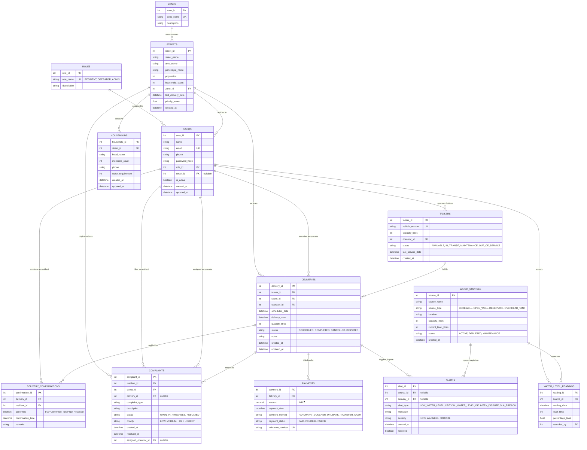

# JalNyaya - Entity-Relationship (ER) Diagram

This document presents the complete Entity-Relationship diagram for the **JalNyaya Water Tanker Distribution & Equity Tracker**. Every implemented table in the database is represented with its primary keys, foreign keys, attributes, and relationship cardinality.

---

## 1. Mermaid Entity-Relationship Diagram

---

## 2. Table Summary & Cardinality Analysis

| Relationship | Type | Cardinality | Explanation |
|---|:---:|:---:|---|
| **Roles → Users** | One-to-Many | `1 : N` | One system role is assigned to many users. A user has exactly one role. |
| **Zones → Streets** | One-to-Many | `1 : N` | An administrative zone covers multiple streets. A street belongs to one zone. |
| **Streets → Households** | One-to-Many | `1 : N` | A street contains multiple consumer households. A household belongs to one street. |
| **Streets → Deliveries** | One-to-Many | `1 : N` | A street receives multiple tanker deliveries over time. |
| **Users (Operator) → Tankers** | One-to-Many | `1 : N` | A driver-operator can be assigned one or more tankers in the panchayat fleet. |
| **Tankers → Deliveries** | One-to-Many | `1 : N` | A tanker carries out multiple delivery trips. |
| **Deliveries → Confirmations** | One-to-Many | `1 : N` | A completed delivery can be confirmed or disputed by resident representatives. |
| **Deliveries → Payments** | One-to-Many | `1 : N` | Each delivery trip generates a payment voucher or receipt record. |
| **WaterSources → Readings** | One-to-Many | `1 : N` | A water source accumulates periodic time-series depth/volume readings. |
| **Complaints → Users / Streets** | Many-to-One | `N : 1` | Multiple residents can lodge complaints originating from their respective streets. |
